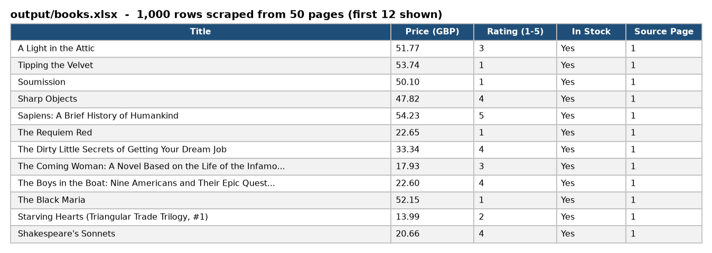
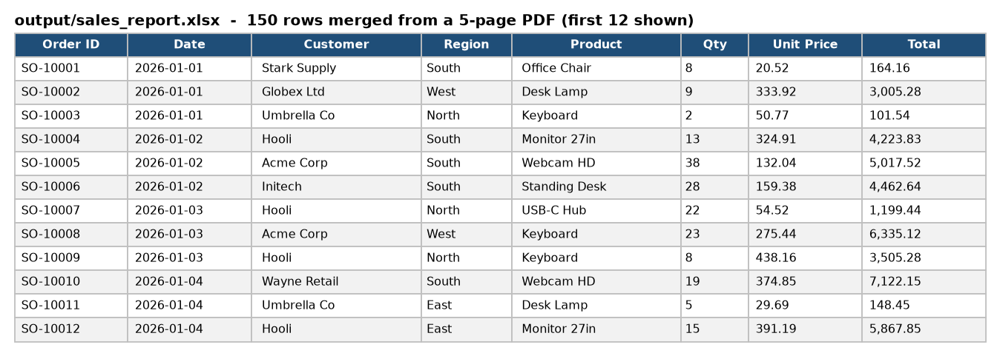
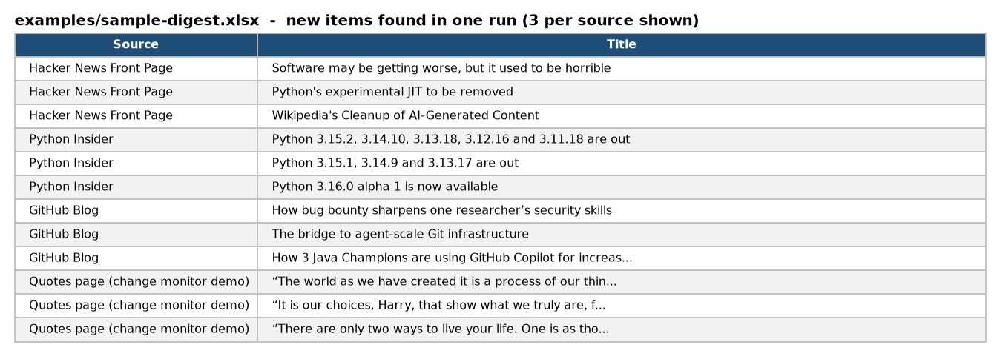
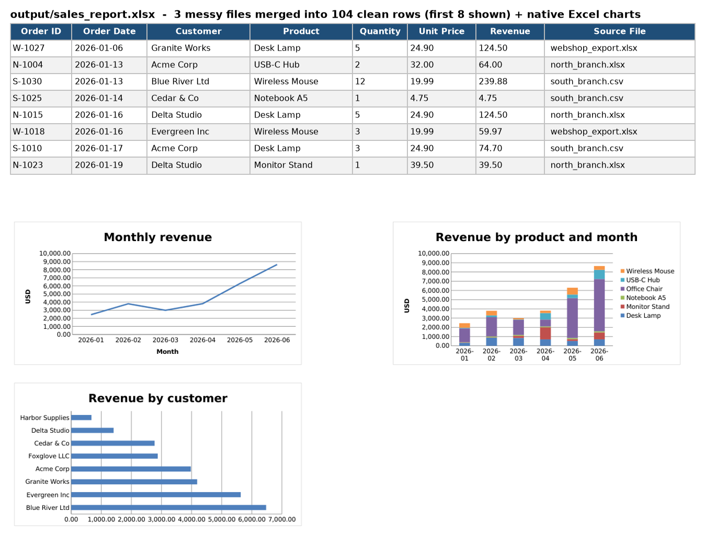
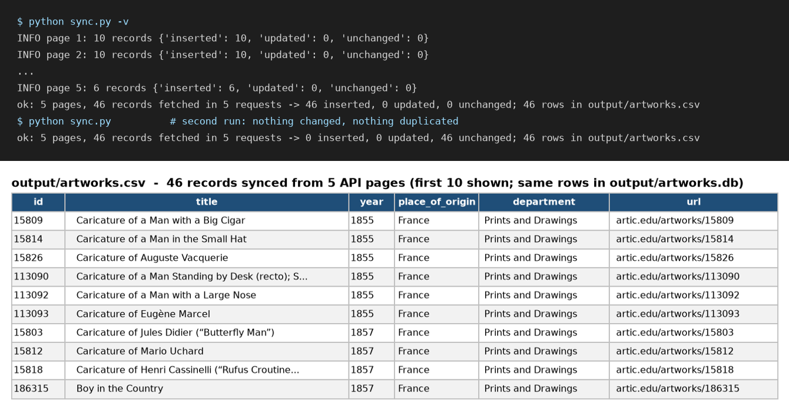
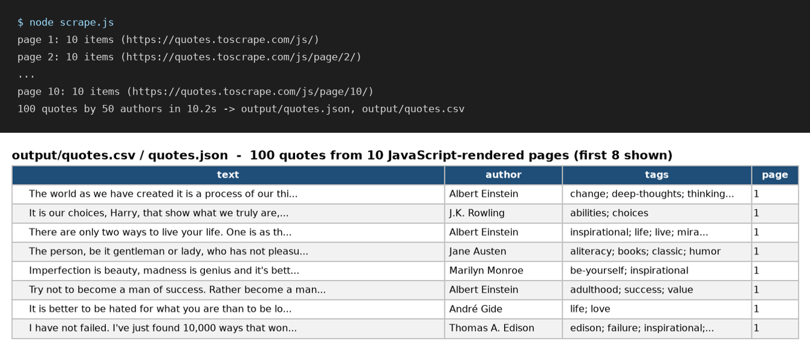
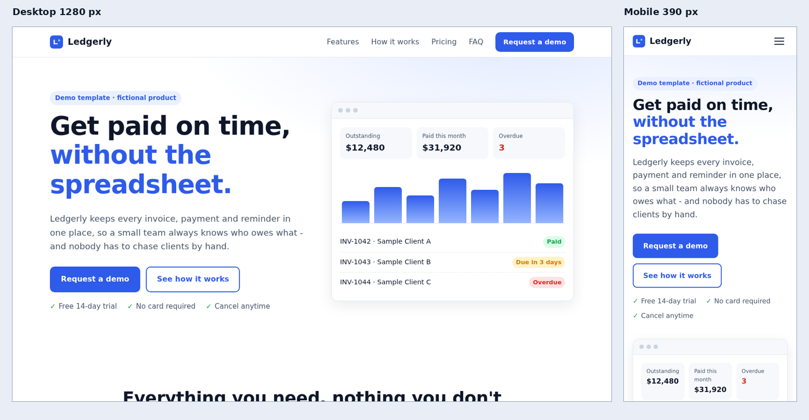
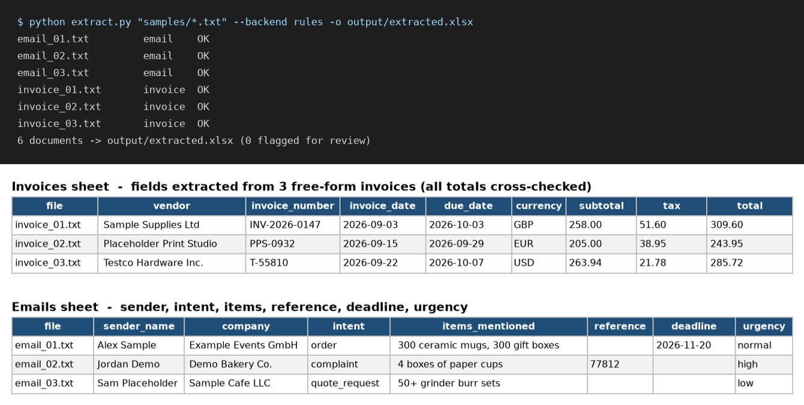

# Freelance Portfolio - Automation, Data and Web Samples

Eight small, complete, runnable projects that show how I approach typical data, automation and web jobs: clean code, one-command runs, real sample output, and tests.

| Sample | What it does | Stack |
|---|---|---|
| [web-scraper-to-excel](web-scraper-to-excel/) | Scrapes every page of a listing site, cleans and de-duplicates the data, exports a formatted Excel workbook (1,000 rows from 50 pages in the included run). | requests, BeautifulSoup, openpyxl |
| [pdf-table-to-excel](pdf-table-to-excel/) | Merges a table spanning many PDF pages into one clean Excel sheet and CSV: repeated headers removed, header-less continuation pages kept, numbers converted. Verified 150/150 rows against the source data. | pdfplumber, ReportLab, openpyxl |
| [automation-workflow](automation-workflow/) | Config-driven RSS + web page monitor that reports only new items as a daily Markdown/Excel digest and can push to Slack, Discord or any webhook. Includes an equivalent importable n8n workflow. | feedparser, requests, PyYAML, n8n |
| [excel-data-cleaner](excel-data-cleaner/) | Merges Excel/CSV exports with different column names, mixed date formats, duplicates and blanks into one clean table, plus a pivot summary and native Excel charts; every dropped row is logged. 104/104 rows verified against the source data. | pandas, openpyxl |
| [rest-api-integration](rest-api-integration/) | Syncs a paginated public REST API into SQLite and CSV with retries, back-off, rate limiting and safe re-runs (upsert, inserted/updated/unchanged counts, run log). Optional Google Sheets export, off by default. | requests, SQLite, gspread (optional) |
| [js-headless-scraper](js-headless-scraper/) | Scrapes a JavaScript-rendered site with a headless browser, follows pagination, exports JSON and CSV (100 records from 10 pages in the included run). Proxy and system-Chromium support. | Node.js, Playwright |
| [landing-page-site](landing-page-site/) | Responsive single-page landing page in plain HTML/CSS/JS (about 22 KB, no external requests), validated placeholder contact form, strict CSP, browser tests at 4 screen widths, deploy guides for Cloudflare Pages and GitHub Pages. | HTML, CSS, JavaScript, Playwright (tests) |
| [ai-text-extractor](ai-text-extractor/) | Extracts structured fields from free-form invoices and e-mails into Excel with any OpenAI-compatible LLM, validates types and invoice arithmetic, flags doubtful rows for review. Offline rules backend for demo and tests. | Python, OpenAI-compatible API, openpyxl |

Each folder has its own README (problem, output screenshots, install and run steps, how to adapt it), a `requirements.txt` or `package.json`, and offline tests:

```bash
# Python samples
cd excel-data-cleaner          # or any other Python sample
pip install -r requirements.txt
python -m unittest -v

# Node.js samples (js-headless-scraper, landing-page-site)
cd js-headless-scraper
npm install
npx playwright install chromium   # or use an installed Chromium, see the sample README
npm test
```

Previews:

| Web scraper | PDF table extraction | Daily digest | Excel data cleaner |
|---|---|---|---|
|  |  |  |  |

| REST API sync | JS headless scraper | Landing page | AI text extractor |
|---|---|---|---|
|  |  |  |  |

All sample data comes from public practice sites, public APIs and RSS feeds, or is generated/invented by the included scripts and clearly marked as demo data.

## License

MIT - see [LICENSE](LICENSE).
