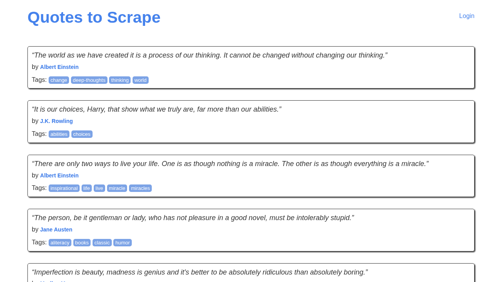

# JS Headless Scraper - Playwright (Node.js) -> JSON + CSV

Scrapes websites whose content is **rendered by JavaScript** - where `requests`/BeautifulSoup or a plain `curl` return an empty page - using **Playwright with headless Chromium**. Follows pagination and exports clean **JSON and CSV**.

The demo target is [quotes.toscrape.com/js](https://quotes.toscrape.com/js/), a public practice site whose quotes are injected by a script after the page loads.

## What problem it solves

More and more sites (shops, directories, dashboards, single-page apps) build the page in the browser. The data is not in the HTML source, so classic scrapers find nothing. This tool drives a real browser and:

- **waits for the JavaScript-rendered items** to appear instead of using fixed sleeps
- **follows the "Next" link** and checks the new page's items replaced the old ones before reading (no duplicated or half-loaded pages)
- **cleans text** (curly quotes, whitespace), **de-duplicates** records
- writes **JSON** (nested, tags as a list) and **CSV** (UTF-8 with BOM so Excel shows accents correctly, tags joined with `; `)
- optional **screenshot** of the first page as proof of what the browser saw
- works behind a **proxy** (`HTTPS_PROXY` with user:password is passed to Chromium) and can use a **system Chromium** where Playwright's own build is not available (see below)
- polite by default: 500 ms pause between pages (`--delay`)

## Output example

Included from a real run: [`output/quotes.json`](output/quotes.json) and [`output/quotes.csv`](output/quotes.csv) - **100 quotes by 50 authors from 10 pages** in about 10 seconds.


```json
{
  "text": "It is our choices, Harry, that show what we truly are, far more than our abilities.",
  "author": "J.K. Rowling",
  "tags": ["abilities", "choices"],
  "page": 1
}
```

What the headless browser rendered on page 1 ([`docs/page1-headless.png`](docs/page1-headless.png)):



## Install and run

Requires Node.js 18+.

```bash
npm install
npx playwright install chromium            # downloads Playwright's Chromium (Windows, macOS, x86-64 Linux)
node scrape.js                             # all pages -> output/quotes.json + output/quotes.csv
node scrape.js --max-pages 3 --out data
node scrape.js --screenshot docs/page1.png --delay 1000
```

**Using an installed Chrome/Chromium instead** (e.g. ARM64 Linux servers, where Playwright's download is not available, or Docker images that already contain Chromium): skip `npx playwright install` and either set `CHROMIUM_PATH=/usr/bin/chromium`, or let the script find a system Chromium/Chrome automatically. The included output was produced this way, on ARM64 Debian with the distro's `chromium` package (`apt install chromium`).

Tests:

```bash
npm test
```

- `test/lib.test.js` - cleaning, de-duplication, CSV escaping, proxy parsing (no browser needed)
- `test/browser.test.js` - end-to-end with a real headless browser against a **local fixture site** (`test/fixtures/page.html`) that renders its items with JavaScript and has two pages; no internet needed. It is skipped, not failed, if no Chromium is installed.

## Adapting it to your site

1. **`SELECTORS`** in `scrape.js` - the item container and the fields inside it, plus the "next page" link.
2. **The `$$eval` mapper** - add fields (price, link `href`, image `src`, attributes) and matching columns in `lib.js` -> `writeOutputs()`.
3. **Pagination style** - for infinite scroll, replace the click with `page.mouse.wheel()` in a loop until the item count stops growing; for `?page=N` URLs, `page.goto()` each URL.
4. **Logins / forms** - `page.fill()` + `page.click()` before scraping, and `context.storageState()` to reuse the session.
5. **Faster alternative** - many JS sites load their data from a JSON API; if the Network tab shows one, calling it directly (see the `rest-api-integration` sample) is faster than a browser.

Please scrape responsibly: respect the site's terms and `robots.txt`, keep a delay between pages, and do not collect personal data you are not allowed to process.

## Project structure

```
scrape.js                  # Playwright scraper (CLI)
lib.js                     # browser launch (proxy / system Chromium), cleaning, CSV/JSON output
test/lib.test.js           # unit tests
test/browser.test.js       # end-to-end test against a local JS-rendered fixture
test/fixtures/page.html
output/                    # quotes.json + quotes.csv from a real run
docs/                      # preview.png (output), page1-headless.png (browser screenshot)
package.json               # dependency: playwright
```

## License

MIT
