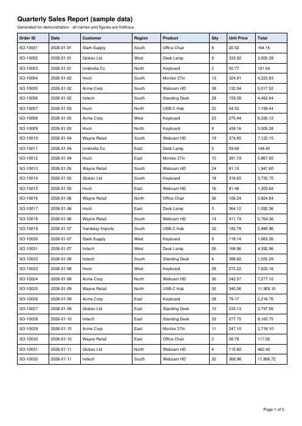

# PDF Table to Excel

Extract a table that runs across many PDF pages into **one clean Excel sheet and CSV**: repeated headers removed, continuation pages kept, page titles and footers ignored, numbers converted to real numbers.

Built with [pdfplumber](https://github.com/jsvine/pdfplumber) and [openpyxl](https://openpyxl.readthedocs.io/). A generator for a realistic sample PDF (made with ReportLab) is included, so everything runs out of the box.

## What problem it solves

Reports, statements and ERP exports often arrive as multi-page PDFs. Copy-pasting them into Excel breaks columns, duplicates the header on every page and leaves numbers as text. This tool:

- detects the table on every page (ruled tables by default, borderless supported via one setting)
- keeps the header **once**, even when each page repeats it
- keeps pages that continue the table **without** a header (page 3 of the sample is built that way on purpose)
- drops empty rows and skips malformed rows with a warning instead of corrupting columns
- converts `1,234.50` / `$12` to numbers (auto-detected, or choose columns with `--numeric`)
- writes `.xlsx` (bold header, frozen first row, filters, auto column widths, number formats, plus an **Extraction report** sheet with rows per page) and a UTF-8 `.csv` that opens cleanly in Excel

## Sample input and output

Included files:

- Input: [`samples/sales_report.pdf`](samples/sales_report.pdf) - 150 rows over 5 pages, with page titles and "Page X of Y" footers
- Output: [`output/sales_report.xlsx`](output/sales_report.xlsx) and [`output/sales_report.csv`](output/sales_report.csv)
- Ground truth: [`samples/sales_report_expected.csv`](samples/sales_report_expected.csv) - the data the PDF was generated from

The extracted CSV matches the ground truth exactly (150 of 150 rows, all 8 columns).

Input (page 1):



Output:


```
INFO page 1: 1 table(s), 32 data rows
INFO page 2: 1 table(s), 32 data rows
INFO page 3: 1 table(s), 32 data rows     <- no header on this page, still captured
INFO page 4: 1 table(s), 32 data rows
INFO page 5: 1 table(s), 22 data rows
INFO 150 rows x 8 columns -> output/sales_report.xlsx and .csv (numeric: Qty, Unit Price, Total)
```

## Install and run

Requires Python 3.9+.

```bash
pip install -r requirements.txt

python make_sample_pdf.py                    # optional: regenerate the sample PDF
python extract.py samples/sales_report.pdf   # -> output/sales_report.xlsx + .csv

# your own file
python extract.py path/to/report.pdf --out-dir results
python extract.py report.pdf --pages 2-6 --numeric "Amount,Balance"
```

Run the tests (generate a PDF, extract it, compare with the source data):

```bash
python -m unittest -v
```

## Adapting it to your PDFs

- **Borderless tables**: in `extract.py` set `TABLE_SETTINGS` to `{"vertical_strategy": "text", "horizontal_strategy": "text"}`.
- **Only some pages**: `--pages 3-10,12`.
- **Several different tables per file**: `extract_rows()` already loops over every table on a page; group them by header to write one sheet per table.
- **Custom cleanup** (dates, negative numbers in brackets, currency columns): extend `to_number()` or add a column-specific step before `write_xlsx()`.
- **Scanned PDFs** (images, no text layer) need OCR first, e.g. `ocrmypdf input.pdf output.pdf`, then run this tool on the result.

## Project structure

```
extract.py               # PDF -> merged table -> xlsx + csv (CLI)
make_sample_pdf.py       # builds the multi-page sample PDF + expected CSV
tests/test_roundtrip.py  # end-to-end accuracy test
samples/                 # sample input and ground truth
output/                  # sample output
docs/                    # screenshots
```

## License

MIT
